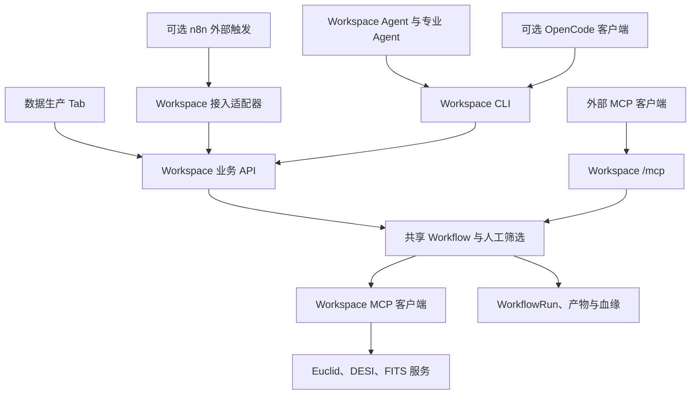

# Agentic 天文工作流技术路线评估

日期：2026-11-03。状态：技术路径建议与源码调研完成；外部方案兼容性 PoC、性能测试和上线验收尚未完成。

建议采用 **Workspace Agent → Workspace CLI → Workspace Workflow** 作为产品执行路径。数据生产 Tab 调用相同的 Workflow；Agent 负责理解需求、准备参数、解释结果和协调专业 Agent，确定性的科学步骤由 Workflow 执行。n8n 保留为外部触发和系统集成选项；OpenCode 保留为可调用 Workspace CLI 的替代 Agent 客户端。此建议来自下面的能力证据与集成成本分析，不代表两种外部方案已经完成运行对比。

## 约束与评估范围

本次选择服从用户确定的产品边界：以 Workspace 为主；数据生产 Tab 可以调整；Agent 应通过 CLI 操作 Workspace；可复用的 astro-code 能力按需吸收。资产、任务状态、人工决策、产物和血缘均由 Workspace 管理。

当前本地代码已经提供可承接这一边界的接口：

- [WorkspaceAgentService](../src/workspace-agent.ts) 提供 `workspace_api`、`create_workflow_run` 和 `delegate_agent`，通过 CLI 执行 Workspace 操作；CLI 路径与 API 地址是服务必填配置，Agent 服务不再注入资产目录、Connector 或生产服务对象。专业 Agent 当前用于只读咨询。Agent 工具发现与执行入口会屏蔽直接 `es_query`、目录查询和 cutout MCP 调用，科学流程须经过注册的 Workflow。
- [Workspace CLI](../packages/cli/src/index.ts) 提供通用 `/api/...` 调用、JSON 输入输出、stdin 和 trace context 透传。通用入口提供扩展面，全部业务操作的语义覆盖仍应按 API 清单逐项验证。
- [Workflow 定义与引擎](../src/workflow-engine.ts) 注册 `euclid-desi-crossmatch@1`，包括输入解析、Euclid 查询、DESI 查询、坐标规范化、球面匹配、人工筛选、可选裁切、导出与血缘登记；[数据生产界面](../viewer/src/workflow-panel.ts) 与 Agent 使用该 Workflow。WorkflowRun 持久化人工筛选决策和成功 FITS cutout 批次，服务启动后可续跑已提交的人工决策并复用已登记批次。
- Workspace 的 `/mcp` 暴露 `euclid_catalog_query`、`desi_catalog_query` 和 `execute_cutout_group`。目录工具转入同一 Workflow 查询实现；cutout 对 ready 本地 Connector 使用 Workspace 内 Astropy/WCS 执行器并登记 Workflow artifact，其他来源调用外部 FITS cutout MCP 的执行与分块读取工具，再登记为 Workspace artifact。源码复核显示当前 `euclid-mcp` 提供 FITS 文件/S3 浏览和分页读取，没有 RA/DEC 圆锥搜索工具；远程目录能力仍依赖可适配的目录 MCP 或默认 `es_query` 端点。
- [WorkflowRun 存储](../src/workflow-store.ts) 保存运行记录与恢复所需的 trace context。这些是当前工作树的源码证据，不是已部署版本的验收证明。

### Bridge 的含义尚未固定

在本次检索的 Workspace README、CONTEXT、docs，以及 astro-code 的 README、docs、ops 范围中，找到 OpenCode 配置和运行说明，未找到可明确识别的 n8n Bridge 实现。这个结论只覆盖上述检索范围。

本文暂将 Bridge 理解为 **n8n、模型接口或 Workspace 之间的 OpenAI 兼容包装／适配层**。仓库地址、版本、接口方向和状态恢复责任尚未形成契约，需要在任何 PoC 前固定。下面两种方向不能共用一个兼容性结论：

1. n8n 的模型节点调用一个自定义 Base URL，Bridge 充当模型服务适配器。
2. Workspace 或其他客户端调用 Bridge，Bridge 将对话请求转换成 n8n 工作流执行。

第一种方向需要验证模型协议兼容性；第二种方向还需要定义工具调用、异步执行、人工等待、会话恢复和错误返回如何跨越包装层。当前不依赖这个未确定的适配层交付 Workspace 主路径。

## 两种方案的能力与适配成本

| 评估项 | n8n + Bridge | OpenCode Multi-Agent | 对 Workspace 的含义 |
| --- | --- | --- | --- |
| Agent 与工具 | Tools Agent 提供基于工具 schema 的调用，可使用 HTTP Request 和 Call n8n Workflow Tool。[N1][N2] | 支持主 Agent、子 Agent，以及由主 Agent 或 `@mention` 调用子 Agent。[O1] | 两者均可协调任务；无需因此迁移 Workspace 的科学步骤。 |
| 接入现有业务 | HTTP Request 可调用 REST API；Workflow Tool 可调用子工作流并读取结果。[N2][N3] | 自定义 JS/TS 工具可调用任意语言脚本，工具上下文包含 session/message ID。[O2] | n8n 可通过 Workspace 适配接口接入；OpenCode 可用自定义工具包装 CLI 的 JSON stdin/stdout。 |
| OpenAI 兼容包装 | OpenAI Chat Model 支持不同 API 模式；源码提供自定义 Base URL，并明确提示工具调用等特性不保证兼容。[N4][N5] | Agent 框架本身不能证明某个 Bridge 的接口兼容性。 | Base URL 可配置仅证明能指定地址；仍需固定 Bridge 与节点版本、API 模式并实测。 |
| MCP | MCP Client Tool 支持外部 MCP 工具、认证与工具选择；所读文档使用 SSE Endpoint 配置。[N6] | 支持本地和远程 MCP；MCP 工具与内置工具一起暴露给模型。[O3] | 主流程由 Workspace MCP 配置与客户端调用服务，才能统一工具发现、运行状态和埋点。n8n 的具体传输兼容性需按版本验证。 |
| 人在回路 | 可在指定工具执行前暂停，批准后按模型给定参数执行，拒绝则取消。[N7] | 可配置 `allow`、`ask`、`deny` 等工具权限。[O4] | 工具执行授权与候选池的科学筛选是两类决策。外部批准不能自动代替 Workspace 的人工筛选记录。 |
| 状态与恢复 | 有独立 execution、历史与重跑机制。[N8] | Headless Server 提供 session、message、permission、事件等接口，并有自己的会话标识。[O5] | 必须映射到 Workspace run ID；外部 execution/session 只保存关联和交互状态。 |
| 权限边界 | HTTP/MCP 工具的凭据及可调用范围需要单独配置。[N3][N6] | 内置文件、Shell 等工具与自定义工具并存，权限可按 Agent 覆盖。[O2][O4] | OpenCode 接入应显式限制宿主工具并暴露受控 CLI 适配器；Workspace 业务权限和决策仍需在业务入口校验。 |
| 部署与维护 | 引入 n8n 运行时；若采用 Bridge，还增加协议适配与版本组合。 | 引入 OpenCode 运行时；嵌入服务还需处理会话与事件映射。[O5] | 当前 Workspace 已有 Agent、CLI 和 Workflow 接口，采用外部编排器会增加集成面。此项为架构判断，未经成本基准测试。 |
| 可观测性 | 工作流执行记录不能直接证明满足本项目 OTel 契约。 | 会话／工具事件不能直接证明满足本项目 OTel 契约。 | 两者均须接入 Workspace 根 trace、CLI、Workflow、MCP 与 HITL 的传播规则，并实际执行验收查询。[W1] |

n8n 适合跨系统定时触发、Webhook 和通知集成。OpenCode 更贴近已有 astro-code 的 Agent 配置与 CLI 使用方式。如果后续确有外部 Agent 客户端需求，可先验证 OpenCode 的受控 CLI 工具；如果出现跨系统自动化需求，再验证 n8n 的调用链。这是按集成边界排序，不是性能排名。

## 执行边界与复用选择

图中的外部接入为建议边界，尚未实现或验证。n8n 的 API 适配器应复用与 CLI 相同的 Workspace 业务接口。Agent 的实际业务执行统一经过 CLI；数据生产 Tab 直接调用相同 API 和 Workflow。任何外部重试都应先查询既有 Workspace run，避免重复创建科学任务；幂等键、重试和恢复语义须在接入契约中明确。

astro-code 的本地参考快照为 `/home/aaron/Repo/astro-code`，提交 `64656b7ffaaef3fbfe0ea84ea1b8ef9131b8562a`。该快照的 `README.md` 描述了 MCP 查询、共享 TS 状态机、人工筛选、`runs/<run_id>/` 文件产物与分组 cutout；`docs/agent-topology.md` 描述了目录、匹配、筛选、报告等角色。这些资料用于识别复用候选，不等于已验证其全部运行行为。

| astro-code 能力 | 处理决定 | 原因及边界 |
| --- | --- | --- |
| tile/source 路径解析、按来源分组 cutout 的调用约定 | 按 Workspace 数据模型吸收；当前实现见 [workflow-cutout.ts](../src/workflow-cutout.ts)。 | 可减少领域适配工作，状态、失败和产物登记仍由 Workspace 管理。 |
| Agent 专业角色、目录字段知识、排障样例 | 提取为 Workspace 专业咨询和工具说明的参考。 | 保留领域知识；实际科学操作使用共享 Workflow。 |
| `runs/` 文件状态机、独立产物索引 | 不迁移为 Workspace 的任务存储。 | Workspace 已有运行、资产与血缘模型，再引入一套会产生同步责任。 |
| `.opencode` 模型／MCP 配置与交互插件 | 留作可选客户端参考，不作为 Workspace 配置来源。 | 避免模型、工具和人工决策配置分叉。 |
| 原 Dockerfile、Chart 与原遥测实现 | 仅参考，不直接替换 Workspace 部署和遥测。 | 服务名、指标、追踪传播和运行角色须符合 Workspace 契约。[W1] |

该 astro-code 快照的 `ops/Dockerfile.orchestrator` 使用 `ghcr.io/nimbleflux/opencode-docker:1.18.4` 并以 `opencode serve` 启动。该镜像标签不能直接作为上游 OpenCode 二进制版本的验证记录；后续 PoC 应记录实际 `opencode --version` 和镜像 digest。

## 后续 PoC 与验收清单

以下条目是待执行计划，本次文档调研没有运行这些测试。

| 验证内容 | 可审查的通过证据 |
| --- | --- |
| 固定版本和 Bridge 契约 | 记录 n8n 镜像 digest、相关节点版本、OpenCode 实际版本、Bridge 仓库／提交；写明调用方向、API 模式、认证、超时和恢复责任。 |
| n8n 模型兼容性 | 验证模型发现、一次普通响应、一次工具调用及结果回传、需要的流式行为、usage、超时与错误；检查工具调用 ID 和 schema 没有被包装层丢失。源码中的 Base URL 与兼容补丁只能作为测试依据。[N5] |
| CLI 业务覆盖 | 通用 `/api/...`、JSON stdin/stdout、失败退出码和 trace context 已有实现；Agent 现在可经 CLI 读取已登记的 CSV/JSON Workflow artifact，默认最多 32 KiB、硬上限 128 KiB。`npm run verify` 通过。完整 Workspace API 矩阵、SSE/备份等特殊请求仍需逐项核对；新工具还未部署到 Dev。 |
| 统一科学流程 | 固定输入和 Workflow 版本，分别从 Tab 与 Agent 触发，比较步骤、候选结果、筛选语义与产物血缘；Agent 入口不能自行另写匹配或跳过人工筛选。 |
| HITL 与恢复 | 人工等待期间重启执行端；原 run 仍可查、决策可恢复、裁切不重复执行。验证拒绝、过期和失败路径；保留两类外部 ID 到 Workspace run 的映射。 |
| 多格式与非标星表 | 当前有 CSV、FITS 表和模拟 S3 reader 回归，覆盖显式列映射、附加字段按目录来源保留、HITL 字段筛选和 CSV 导出；仍需真实 S3、真实目录 MCP 字段投影及科学字段语义验收。Connector 能读取这些格式不等于生产 Workflow 已完成端到端验收。 |
| MCP 实际服务 | Workspace `/mcp` 已注册三个一方工具并复用 Workflow 查询及 Workspace 本地 FITS artifact 路径；当前工作树还支持 Connector 凭据授权的精确 S3 FITS 对象 Range cutout。S3 通配符和其他远程源仍需外部 FITS MCP；仍需部署后端并刷新工具列表，验证目录端点、cutout、失败诊断、产物可读与可用率。`euclid-mcp` 当前源码不提供坐标查询。源码和构建不能证明后端已上线。 |
| 埋点与面板 | 执行 [可观测性需求 §9][W1] 的 T1–T6、N1–N2、P1–P6 和序列预算检查，并保存查询与 Grafana 8 个 Agent & LLM panel 的实际结果。 |
| 五分钟指标 | 固定科学输入、数据版本、环境、目录上限和缓存条件，使用 `queryRadiusArcsec=250`，记录从接收有效输入到候选池可用的耗时；人工筛选和裁切另计。报告限制与样本，不能只以单次演示外推全部查询。 |
| 可用率、试用与发布 | 明确 ≥95% 可用率的统计窗口、成功定义与探测记录；保存至少两位真实研究者的试用和反馈修复证据；正式 v1.0 单独记录 Dockerfile、Chart、版本标签、部署与回归结果。 |

埋点应落在实际执行边界：对话 `chat.turn`、模型 `chat {model}`、CLI／业务工具、Workflow／step、MCP CLIENT `tools/call {tool}`、HITL 决策和恢复、扫描与下载进程。MCP 的 HTTP 头与 `params._meta.traceparent` 必须来自同一次 CLIENT span；人工等待保存上下文并结束活动 span。只向 Collector 发送 OTLP，不把 run ID、路径、URL 或内容写成指标标签；LLM 使用需求规定的两个 GenAI 指标。[W1] 外部编排器增加自己的观测数据时，也不能替代这些 Workspace 执行点。

## 当前证据边界

本报告完成了两种技术路线的官方文档／源码调研和本地架构适配分析，可作为技术路径决策依据。Workspace Agent、CLI、共享 Workflow 和 `/mcp` 工具入口已部署到 Dev：当前为 2026-11-04 的 Helm revision 136，镜像 `0.0.1-dev-20261104-agent-r14`。r14 Pod `asa-workspace-787f98bdc4-vgv7s` Ready、零重启，`/healthz` 返回 200；应用在容器启动约 59 秒后开始监听，startup probe 的初始化期连接拒绝随后恢复。该核对只证明应用启动与健康，不替代业务验收。OpenCode 1.19.4 Workspace CLI PoC 已完成只读调用、权限拒绝、取消和只读子 Agent 运行验收；n8n／Bridge 兼容性 PoC 仍待固定 Bridge 仓库、版本和协议方向。

Dev 复验通过 Workspace CLI 创建 `wfr_20261103193329_f932665a`，读取两份已登记的 S3 FITS 星表（Euclid 214 行、DESI 500 行），在约 26 秒内生成 46 个候选，随后停在人审闸门。候选记录包含从文件名推断的 tile `102018211` 与 brick `0583m512`；没有提交人工决策，故 cutout 和导出没有执行。Tempo 按 `asa.workflow.run_id` 查到该执行的根 trace 和 17 个运行 span，包含 catalog read、step、crossmatch tool 事件。该结果验证 Workspace CLI 到共享 Workflow 的 FITS 资产路径与运行级埋点，不等同于实时 Euclid／DESI MCP 查询或完整端到端裁切。

r14 另外完成 Agent → Workspace CLI 的只读线上验收：Agent 会话 `wag_bbd894c0-dc65-46af-944f-1c8741970c69` 返回 `euclid-desi-crossmatch@1`，Tempo trace `93ae2deb06f2c850e74914e4f7cfb22c` 包含 `chat.turn`、模型请求、`execute_tool list_workflows` 和 `subprocess workspace-cli`。Workspace `/mcp` 也列出预期五项工具，并对已登记 Euclid/DESI S3 FITS 星表在 `radiusArcsec=250` 下分别查询到 214/500 行，合计约 16.47 秒。该查询时长不是完整候选池的性能测量；它不覆盖外部目录 MCP、图像 cutout 或人工筛选后的导出。

该 r14 trace 在 Tempo 有 10 个 span，`chat.turn` 为根；两次模型请求都携带 token usage，且未发现 prompt、模型输出或工具参数内容属性。Collector 预采样指标记录 1 个 chat turn、2 次 LLM 请求与 4,161/60 个 input/output token，但当前镜像将模型指标标签折叠为 `other`。本地已补入 `gpt-6-luna` 有界枚举，尚未部署。servicegraph 目前只有 Workspace → LLM gateway，没有 Workspace → `astro-sdk-services`；r14 只读调用没有生成 Workflow key 维度或 HITL 决策 span。详见 [session handoff](session-handoff-20261103-agent.md)。

本地回归现已通过（428 项中 424 passed、4 skipped）；Workspace 镜像也已在本机 Podman 构建并通过容器 `/healthz` 与 CLI Workflow 列表 smoke。该镜像未推送或部署，不作为 Dev/v1.0 发布证据。当前集群没有默认目录 MCP 所引用 Elasticsearch IP 的 Service/Endpoint；现有 ES 索引不能证明是 Euclid Q1/DESI DR10 目标数据，仍需确认外部目录后端。

Dev 系统配置仍没有外联 Workspace MCP Server；`/mcp` 的一方工具入口与已登记 S3 catalog 读取不能证明外部 MCP 服务已上线。真实目录 MCP 查询、生产 S3 图像裁切、五分钟目标的代表性性能、MCP 可用率、真实用户试用、完整面板验收和 v1.0 发布仍需要各自运行证据，不能由本文或构建通过推定完成。详见 [session handoff](session-handoff-20261103-agent.md)。

r11 的只读 Workspace `/mcp` smoke 成功列出五项工具、读取 23 个资产，并从已登记 S3 FITS 资产查询出 Euclid 214 行、DESI 500 行；但这些真实 MCP 调用在 Tempo 和预采样 spanmetrics 中没有对应工具 span。隔离进程直接调用 service method 可产生可查的 root span，因此只能证明 helper/exporter 工作，不能证明 MCP transport 埋点通过。真实 MCP trace 验收仍未完成；详情见 [session handoff](session-handoff-20261103-agent.md)。

r12 修复了 `text/event-stream` HTTP 请求上下文中的 OTel tracing suppression。部署后再次通过真实 Streamable HTTP `/mcp` transport 执行同样的只读资产查询；等待尾采样窗口后，Tempo 中出现 Euclid/DESI MCP tool root 及 catalog read/query 子 span，Collector 预采样 spanmetrics 也记录到两次调用。Euclid trace `db2f2c5bc8b72af54ba72eb061af1bc5` 和 DESI trace `330bb47bff77476cd9954e2b7b0544bb` 各含 5 个 span；另观察到 handler 与 query service 层各创建一个同名 root，二者通过 span link 关联，产生额外单 span trace。该证据证明 Workspace MCP transport 埋点链路可用，但仍不是外部目录 MCP 后端、图像 cutout 或服务可用率验收。`withRootSpan()` 回归测试及完整构建通过；Pod `asa-workspace-6f64c5d5b-6ng8s` Ready、零重启，`/healthz` 返回 200。部署和运行边界见 [session handoff](session-handoff-20261103-agent.md)。

r13 将目录查询与 cutout 的 root span 交给各自 service 层管理，HTTP route 只为没有 service root 的资产工具创建 root，消除了重复根 trace。全量 `npm test` 通过（427 项，423 passed、4 skipped、0 failed），`npm run build` 和 `npm run verify:chart` 通过。revision 135 的真实 `/mcp` 查询在 Tempo 留下 Euclid trace `e8d480377d812cba35ee3741135c58b6` 与 DESI trace `39bcd2b977b47d19200720d699f9cd9`，各有 5 个 span；Collector 每个目录工具只有一条带对应 `asa_step_id` 的 spanmetrics 序列（count=1）。这覆盖已登记 S3 FITS 资产的 Workspace MCP 查询，不覆盖外部目录服务、FITS cutout 或用户试用。详见 [session handoff](session-handoff-20261103-agent.md)。

## 一手来源

外部资料访问日期均为 2026-11-03。文档页面可能更新；n8n 源码引用固定到提交 `c1420c66253871bacecbe7148754ca050a81e7f2`，该提交用于说明能力，不代表本项目已采用或验证该版本。

- [N1 — n8n Tools Agent](https://docs.n8n.io/integrations/builtin/cluster-nodes/root-nodes/n8n-nodes-langchain.agent/tools-agent/)
- [N2 — n8n Call n8n Workflow Tool](https://docs.n8n.io/integrations/builtin/cluster-nodes/sub-nodes/n8n-nodes-langchain.toolworkflow/)
- [N3 — n8n HTTP Request](https://docs.n8n.io/integrations/builtin/core-nodes/n8n-nodes-base.httprequest/)
- [N4 — n8n OpenAI Chat Model](https://docs.n8n.io/integrations/builtin/cluster-nodes/sub-nodes/n8n-nodes-langchain.lmchatopenai/)
- [N5 — n8n LmChatOpenAi 源码](https://github.com/n8n-io/n8n/blob/c1420c66253871bacecbe7148754ca050a81e7f2/packages/%40n8n/nodes-langchain/nodes/llms/LMChatOpenAi/LmChatOpenAi.node.ts#L242) 与 [OpenAiApi credentials](https://github.com/n8n-io/n8n/blob/c1420c66253871bacecbe7148754ca050a81e7f2/packages/nodes-base/credentials/OpenAiApi.credentials.ts#L35)：Base URL、模式选择和兼容性边界。
- [N6 — n8n MCP Client Tool](https://docs.n8n.io/integrations/builtin/cluster-nodes/sub-nodes/n8n-nodes-langchain.toolmcp/)
- [N7 — n8n Human review for AI tool calls](https://docs.n8n.io/advanced-ai/human-in-the-loop-tools/)
- [N8 — n8n Executions](https://docs.n8n.io/workflows/executions/)
- [O1 — OpenCode Agents](https://opencode.ai/docs/agents/)
- [O2 — OpenCode Custom Tools](https://opencode.ai/docs/custom-tools/)
- [O3 — OpenCode MCP Servers](https://opencode.ai/docs/mcp-servers/)
- [O4 — OpenCode Permissions](https://opencode.ai/docs/permissions/)
- [O5 — OpenCode Server](https://opencode.ai/docs/server/)
- [W1 — Workspace 可观测性埋点需求 v0.3](../.tmp/WORKSPACE_REQUIREMENTS.md)

[N1]: https://docs.n8n.io/integrations/builtin/cluster-nodes/root-nodes/n8n-nodes-langchain.agent/tools-agent/
[N2]: https://docs.n8n.io/integrations/builtin/cluster-nodes/sub-nodes/n8n-nodes-langchain.toolworkflow/
[N3]: https://docs.n8n.io/integrations/builtin/core-nodes/n8n-nodes-base.httprequest/
[N4]: https://docs.n8n.io/integrations/builtin/cluster-nodes/sub-nodes/n8n-nodes-langchain.lmchatopenai/
[N5]: https://github.com/n8n-io/n8n/blob/c1420c66253871bacecbe7148754ca050a81e7f2/packages/%40n8n/nodes-langchain/nodes/llms/LMChatOpenAi/LmChatOpenAi.node.ts
[N6]: https://docs.n8n.io/integrations/builtin/cluster-nodes/sub-nodes/n8n-nodes-langchain.toolmcp/
[N7]: https://docs.n8n.io/advanced-ai/human-in-the-loop-tools/
[N8]: https://docs.n8n.io/workflows/executions/
[O1]: https://opencode.ai/docs/agents/
[O2]: https://opencode.ai/docs/custom-tools/
[O3]: https://opencode.ai/docs/mcp-servers/
[O4]: https://opencode.ai/docs/permissions/
[O5]: https://opencode.ai/docs/server/
[W1]: ../.tmp/WORKSPACE_REQUIREMENTS.md
